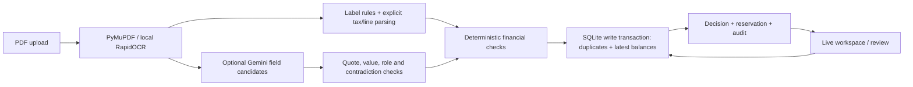

# Ledgerflow · PS-1 invoice processing

A real invoice PDF becomes an explainable AP decision: **approved**, **needs review**, or **rejected**. Approval reserves purchase-order authorization. It does not send a payment or email.

**Live:** https://ledgerflow.expediva.in — enter the workspace access code supplied privately by the owner. This revision (policy AP-1.1) was deployed on 2026-11-06 and checked end to end over public HTTPS; results are in [VALIDATION.md](VALIDATION.md).

Procurement records and provided invoices are **synthetic**. PDF reading, OCR, policy checks, decisions, audit events, and SQLite reservations actually execute. Sample names do not select decision outcomes.

## Start locally

Python 3.12 on Linux:

```bash
python3.12 -m venv .venv
.venv/bin/pip install -r requirements.txt
.venv/bin/python dev.py
# Open http://127.0.0.1:8000
```

Use `.venv/bin/python dev.py --fresh` for a new temporary local rehearsal directory; existing history is preserved. No API key is required for PDF text or local neural OCR. Minimal Linux images need `libgl1`, `libglib2.0-0` and `libgomp1` for OpenCV/ONNX. Configuration is read from environment variables; `.env` files are not automatically loaded. See [.env.example](.env.example).

## Evaluator walkthrough

Choose **Try a sample**. Each click creates an independent scenario with its own duplicate history and PO commitments. You can revisit any sample without resetting anyone's work. Sample reservations do not alter the real-upload PO register. The duplicate scenario first processes an original PDF in its own scenario, then processes a re-export through the same engine. Actual repeated uploads retain duplicate protection.

Start with the clean invoice; then use the four primary stories below. In each workspace, failed or uncertain checks appear first. **Extracted fields** shows source evidence, page numbers, calculations, line charges, and the PDF alongside them on wide displays. **Audit trail** and JSON export retain original decisions and fields before human changes.

| Story | Operational risk and decision | Evidence, next action and final outcome |
|---|---|---|
| Happy path: **A clean invoice** | Reserve $4,950, without sending a payment. | PO $12,000 less $4,000 previously committed leaves $8,000; approval leaves $3,050 in this isolated scenario. |
| 1. **Same invoice. Different PDF.** | A re-export could be approved twice. **Rejected.** | Different SHA-256; same approved vendor + normalized invoice number. Open the linked original. Only the original reserves $4,950; no reviewer override. |
| 2. **The balance tells a different story** | A $2,450 invoice fits the original $10,000 PO, but not its remaining $2,000. **Needs review.** | Prior commitments are $8,000; shortfall is $450. Procurement must authorize more budget or the vendor must correct the invoice. Reviewer approval remains blocked; nothing reserved. |
| 3. **Inclusive tax, reconciled charges** | Treating inclusive charges as net would double count tax. **Approved after reconciliation.** | Bundles $708 + $472 = $1,180 gross, explicitly inclusive of 18% tax. Net = $1,180 / 1.18 = $1,000; tax = $180. No quantities invented. Amount-only PO limitation is shown. |
| 4. **Two possible purchase orders** | No PO reference and two eligible orders; guessing could charge the wrong budget. **Needs review.** | Select `PO-2026-1048`, enter your name and “Verified the PDF and confirmed the cloud infrastructure purchase order.” Then **Verify & approve**. Rechecks reserve $990 and leave $7,010 in this scenario; original review decision stays in the audit. |

Supporting samples: **Itemised charges, separate tax** demonstrates the equivalent $1,000 + $180 = $1,180 with quantities/prices. Two scans demonstrate successful OCR and a missing-date hold. **A layout the labels miss** is read by the optional Gemini reader when a key is configured. Without one, it correctly stays in review because required fields are missing.

The narrated script is in [DEMO_SCRIPT.md](DEMO_SCRIPT.md); measured test and deployment results are in [VALIDATION.md](VALIDATION.md).

## Architecture and AI boundary



FastAPI serves plain JavaScript and streams persisted stage events. SQLite stores procurement records, invoices, results and reviews; PDFs are retained on disk. Two worker threads read documents. A single `BEGIN IMMEDIATE` transaction rechecks duplicate identity, latest gross balance and cumulative PO line quantities, then writes the decision and reservation. Retries return the committed automated result; repeated reviewer approvals are refused. Interrupted work is marked failed after restart. A later timeline failure cannot undo a financial commit or leave the event stream waiting for a missing final event.

With `GEMINI_API_KEY` configured, Gemini is consulted **only when the label rules leave required fields unread**. An invoice the rules read completely never waits on, or depends on, the provider's availability or quota. Free-tier keys allow only a few requests per minute. Setting `GEMINI_CROSSCHECK=1` also double-reads rule-read invoices: supported, contradictory candidates are retained and force review, and a provider failure then holds even a labelled invoice. In either mode, the model cannot overwrite a rule value or resolve an existing conflict. Quote occurrence, value and field-role checks reject common wrong-line readings such as “previous balance” or “amount paid.” Documents containing payment/prior-balance language are conservatively held even when arithmetic balances.

**Quotes and arithmetic do not guarantee correct extraction.** Semantic checks are intentionally limited English rules. The model is a reader; it never decides vendor authorization, duplicates, arithmetic, tolerances, PO allocation, or spending. Invoice instructions are untrusted data, separated from system instructions. No tools are supplied to the model. Only document text is sent to Gemini, not the PDF or application secrets. Provider failure, invalid responses, and a 25-second default timeout produce a visible review reason. No key means label rules and local OCR only; missing fields still cause review.

`GEMINI_MODEL` is a comma-separated fallback list. The default is `gemini-3.5-flash-lite,gemini-3.1-flash-lite,gemini-3.5-flash`, all verified against the live API on 2026-11-06. Each model has its own free-tier quota (as little as 20 requests/day), so a model that is out of quota (429), overloaded (503) or times out passes the request to the next. A model that answers but finds nothing does not, so a non-invoice does not spend every model's quota. Older models such as `gemini-2.5-flash` are no longer offered to new keys. The request uses Google's documented [generateContent API](https://ai.google.dev/api/generate-content), with system instructions and a response schema.

## Policy AP-1.1

Amounts use integer minor units; calculations use `Decimal` and half-up rounding. USD, INR, EUR and GBP use two decimal places. Values displayed in examples are currency units.

| Rule | Basis and inclusive boundary | Outcome |
|---|---|---|
| Arithmetic rounding | Absolute difference ≤ **0.01** for subtotal + tax vs total, quantity × unit price vs printed line amount, line sums vs document basis, and stated tax-rate calculations. | Larger variance → review. This allowance never changes the PO cap. |
| PO line price / amount matching | Absolute variance ≤ **both 1% of expected PO basis and 2.00**. The permitted amount is the smaller limit, floored to minor units. Configurable with `LEDGERFLOW_MATCH_PERCENT` and `LEDGERFLOW_MATCH_ABSOLUTE`. | At/below both limits passes; above either → review. Each comparison shows actual variance, permitted variance and basis. |
| Quantity authorization | Invoice quantity ≤ ordered quantity − explicit opening quantity − quantities approved here. No quantity tolerance. | Missing opening allocation or excess quantity → review. Rechecked under the reservation lock. |
| Gross spending authorization | Invoice total ≤ original PO amount − opening commitments − approved invoices here. **Authorization allowance is zero.** | Any overrun, including 0.01, stays blocked pending procurement authorization/correction. Matching tolerance cannot authorize spending. |

For a PO line amount with explicit ordered and invoiced quantities, the expected amount is prorated by invoiced quantity / ordered quantity and rounded half up. Unit price uses the ordered unit price. Exact description matching must identify one unused PO line; bundled-to-multiple-line mappings are held. Invoice and PO line tax bases must agree (`net` by default, or explicit `gross`). A PO's optional `line_items` JSON holds `description`, `quantity`, `opening_quantity`, `unit_price`, `amount`, and `tax_basis`; prices/amounts are minor units. These are procurement records, not editable model output. Seeded POs are amount-only: vendor/currency/gross remaining capacity are checked; quantities, prices and delivery cannot be verified against them. Partial invoices are not expected to equal the full PO amount.

Tax may be separately stated, including explicit zero, or explicitly inclusive with an applicable rate. For inclusive total 1,180 at 18%, net is rounded from 1,180 / 1.18, and tax is the residual 180. Derived values are labelled with their formula, quote and page. Missing tax is **not zero**. Missing rates for inclusive-only documents, contradictory tax declarations, mixed rates needing unsupported allocation, or inconsistent printed net/tax go to review.

Supported structured tables use `Description | Quantity | Unit price | Amount` (optional `Tax rate` / `Tax amount`) or whitespace-separated columns with matching headers. `Description | Amount` represents service bundles with null quantity and price. Net lines sum to subtotal; explicitly inclusive lines sum to gross total. Unreadable detected tables go to review. This is bounded table support, not universal PDF table reconstruction.

Review requires a name and reason of at least ten characters. A reviewer can select an ambiguous PO, verify reading uncertainty, and correct date/currency/document amounts. **Save corrections & recheck** persists an intermediate review without reserving funds. **Verify & approve** reruns every rule and the current balance. Before/after field history, provenance and original decisions are retained. Vendor, invoice identity and explicit PO replacement require a corrected document, preventing those controls from being bypassed through the correction form. Approval cannot waive tax ambiguity, arithmetic, duplication, price/quantity rules or spending authorization. Names are self-reported, not verified identities.

## Checks

```bash
.venv/bin/pip install -r requirements-dev.txt
.venv/bin/python -m pytest -q
node --check static/app.js
.venv/bin/python dev.py --check
```

See [VALIDATION.md](VALIDATION.md) for measured results: 102 tests pass and all 13 browser acceptance checks pass. HTTP tests skip explicitly in socket-denied environments; route-handler tests still exercise real worker intake → PDF → decision → human review → audit and balances. Browser acceptance uses Chrome against an isolated server and covers upload, review, samples, tax/lines, duplicates, exports, search, mobile navigation, access cookies and proxy headers.

## Deployment

The live instance runs on a single AWS VM. FastAPI runs under systemd (`ledgerflow.service`, bound to `127.0.0.1:8000`), and Caddy terminates HTTPS with automatically issued certificates. Data lives outside the source tree in `LEDGERFLOW_DATA`. Other applications on the VM are untouched. The Docker image below was not built for this deployment; its source manifest includes `ai_extract.py` and `finance.py`.

For a server update: take a SQLite backup (including a consistent WAL checkpoint) and uploaded-file backup; update this application's source/dependencies; restart only its existing service; leave unrelated services and Caddy routes intact. Additive schema migration preserves decisions/commitments. Check `/api/health` reports `AP-1.1`, then sign in and rehearse the happy path, four stories, actual-upload duplicate, correction flow and an AI sample with a legitimate server-side key. Verify HTTPS, downloads and mobile layout before submitting the link. A source-only rollback after new decisions is unsafe without reconciling the database and reservations.

The existing Docker/Render configurations remain available for container hosting:

```bash
docker build -t ledgerflow .
docker run -p 8000:8000 -v ledgerflow-data:/var/lib/ledgerflow \
  -e LEDGERFLOW_ACCESS_TOKEN -e GEMINI_API_KEY -e GEMINI_MODEL ledgerflow
```

Export secrets in your deployment environment; keep them out of files, screenshots and command history. Production access needs `LEDGERFLOW_ACCESS_TOKEN`; only `/api/health` is public. Keep persistent data at `LEDGERFLOW_DATA`.

## Scope and limitations

- English PDFs, up to 10 MB / 12 pages; supported currency codes, ISO dates and decimal-dot money. AI sees at most 12,000 extracted characters. Unsupported layouts/line tables and unknown vendors require review or a corrected document.
- Synthetic vendors/POs, no ERP, goods-receipt verification, banking, email sending, FX, credit notes, or tax-law compliance determination. No measured extraction accuracy or business savings are claimed.
- Single tenant with shared access code, self-reported reviewer names, SQLite and an in-memory two-thread queue. Restarted in-progress work fails visibly; durable queue/disaster recovery is outside this take-home.
- Demo histories are retained and labelled, but not private per evaluator. Scenario isolation protects balances/repeatability; it is not multi-tenant authorization. No global reset endpoint is exposed.
- Real-provider (Gemini) extraction accuracy and the Docker image build are unverified. Next work: a labelled document evaluation set, authentic procurement imports, authenticated reviewer roles and idempotent AP handoff.
